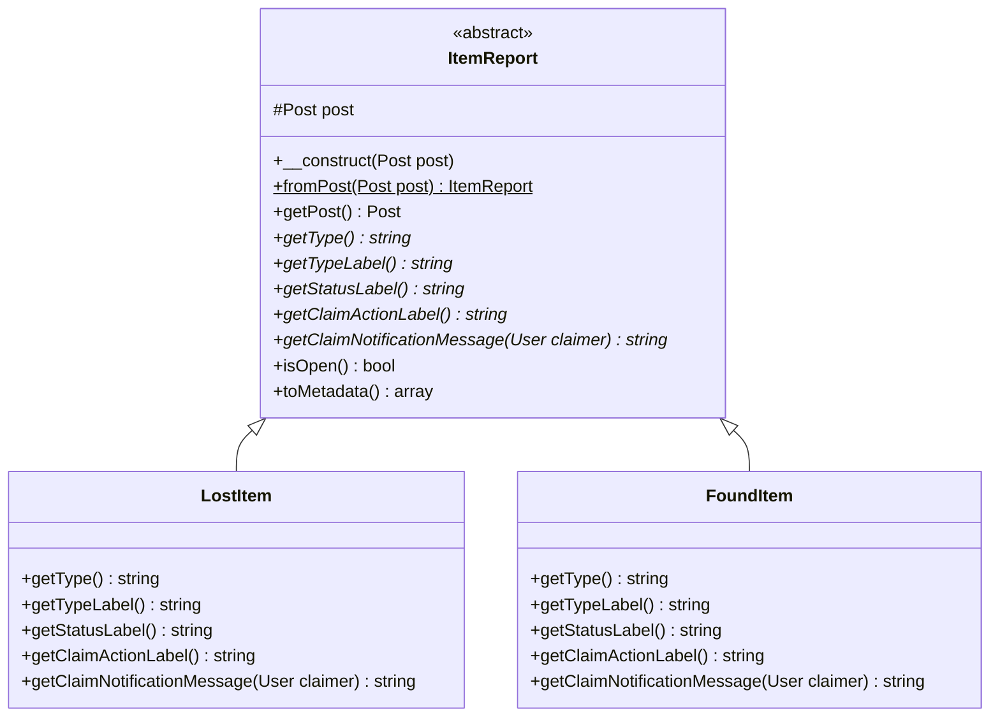

# Dokumentasi Lengkap Proyek — Lost & Found Kampus Widyatama

Dokumen ini merangkum arsitektur sistem, penerapan **Pemrograman Berorientasi Objek (PBO / OOP)**, skema database, daftar perubahan lengkap (*changelog*) pada **Backend** dan **Frontend**, serta panduan menjalankan aplikasi **Lost & Found Kampus**.

---

## Daftar Isi
1. [Arsitektur & Stack Teknologi](#1-arsitektur--stack-teknologi)
2. [Penerapan PBO / OOP di Backend (`ItemReport` Hierarchy)](#2-penerapan-pbo--oop-di-backend-itemreport-hierarchy)
3. [Daftar Lengkap Perubahan & Perbaikan (Changelog)](#3-daftar-lengkap-perubahan--perbaikan-changelog)
   - [3.1. Perubahan Backend](#31-perubahan-backend)
   - [3.2. Perubahan Frontend & Dashboard Admin](#32-perubahan-frontend--dashboard-admin)
4. [Skema Database Terbaru](#4-skema-database-terbaru)
5. [Ringkasan Endpoint REST API Terbaru](#5-ringkasan-endpoint-rest-api-terbaru)
6. [Akun Dummy (Seeder) & Cara Menjalankan](#6-akun-dummy-seeder--cara-menjalankan)

---

## 1. Arsitektur & Stack Teknologi

| Bagian | Teknologi | Lokasi Proyek |
|---|---|---|
| **Backend REST API** | Laravel 13 (PHP 8.4), Laravel Sanctum, Laravel Socialite (`@widyatama.ac.id`), MySQL | `lost-and-found-backend/` |
| **Frontend Web App** | React 19, Vite 8, Tailwind CSS v4, TanStack React Query v5, `@react-oauth/google`, Lucide Icons | `lost-and-found-frontend/` |

---

## 2. Penerapan PBO / OOP di Backend (`ItemReport` Hierarchy)

Untuk memisahkan logika domain antara laporan **Barang Hilang** dan **Barang Ditemukan** tanpa menumpuk percabangan `if/else` di controller, backend menerapkan prinsip **PBO / OOP (Abstraction, Encapsulation, Inheritance, Polymorphism, dan Factory Pattern)** pada namespace `App\Domain\Reports`.

### Diagram Class PBO (`ItemReport`)



### Penjelasan Pilar PBO yang Diterapkan

1. **Abstraction (`app/Domain/Reports/ItemReport.php`)**
   - `ItemReport` adalah `abstract class` yang mendefinisikan kontrak perilaku umum setiap laporan barang melalui method abstrak: `getType()`, `getTypeLabel()`, `getStatusLabel()`, `getClaimActionLabel()`, dan `getClaimNotificationMessage(User $claimer)`.
2. **Encapsulation**
   - Objek Eloquent `Post` disimpan sebagai properti `protected readonly Post $post` di dalam `ItemReport` (menggunakan PHP 8 constructor property promotion), dan hanya diakses melalui getter `getPost()` serta method domain seperti `isOpen()` dan `toMetadata()`.
3. **Inheritance (`LostItem.php` & `FoundItem.php`)**
   - `LostItem extends ItemReport`: Merepresentasikan barang hilang (`kehilangan`), dengan status `"Masih dicari"` / `"Sudah ditemukan"`, label tombol klaim `"Saya Menemukan Ini"`, serta pesan notifikasi penemuan barang.
   - `FoundItem extends ItemReport`: Merepresentasikan barang temuan (`ditemukan`), dengan status `"Menunggu pemilik"` / `"Sudah dikembalikan"`, label tombol klaim `"Ajukan Klaim"`, serta pesan notifikasi klaim kepemilikan.
4. **Polymorphism & Factory Method (`ItemReport::fromPost()` & `Post::asReport()`)**
   - Model `Post` memiliki method `asReport(): ItemReport` yang memanggil factory `ItemReport::fromPost($this)` untuk mengembalikan instance `LostItem` atau `FoundItem` secara otomatis berdasarkan kolom `type`.
   - `ClaimController::store()` memanggil `$post->asReport()->getClaimNotificationMessage($user)` secara polimorfik tanpa perlu mengecek `if ($post->type === ...)`.
   - `Post::toApiArray()` menyertakan hasil `$this->asReport()->toMetadata()` ke dalam field `report_meta` pada response API sehingga Frontend langsung menerima label aksi dan status yang sesuai.

---

## 3. Daftar Lengkap Perubahan & Perbaikan (Changelog)

### 3.1. Perubahan Backend

| Fitur / Area | Perubahan yang Dilakukan | File Terkait |
|---|---|---|
| **Penerapan PBO** | Membuat hierarki `ItemReport` → `LostItem` & `FoundItem` dan mengintegrasikan ke `Post` & `ClaimController`. | `app/Domain/Reports/ItemReport.php`, `LostItem.php`, `FoundItem.php`, `app/Models/Post.php` |
| **Tabel & Fitur Klaim** | Menambahkan tabel `claims` (`post_id`, `claimer_id`, `owner_id`, `message`, `contact_whatsapp`, `status`, `owner_note`, `responded_at`), model `Claim`, dan `ClaimController` (`store`, `myClaims`, `postClaims`, `respond`). Nomor WhatsApp pemilik baru dibuka setelah klaim berstatus `accepted`. | `database/migrations/2026_11_23_000001_add_soft_deletes_and_claims_table.php`, `app/Models/Claim.php`, `app/Http/Controllers/ClaimController.php` |
| **Validasi Upload Foto** | Mengubah aturan validasi foto laporan di `store()` & `update()` menjadi hanya `jpeg/jpg/png`, maksimal **3 foto**, masing-masing maksimal **2MB** (`max:2048`). | `app/Http/Controllers/PostController.php` |
| **Soft Delete & Restore** | Menambahkan `deleted_at` pada tabel `posts` dan trait `SoftDeletes` pada model `Post`. Menghapus laporan kini hanya melakukan soft delete (gambar fisik tetap aman) dan dapat dipulihkan via `GET /api/posts/trashed` dan `POST /api/posts/{id}/restore`. | `app/Models/Post.php`, `app/Http/Controllers/PostController.php`, `routes/api.php` |
| **Optimasi Performa (Load)** | Menghilangkan query N+1 pada list & detail post dengan `withCount(['comments', 'claims'])`, batch query `getSavedPostIds()`, dan batch query `getMyClaimsByPostId()`, serta menambahkan endpoint profil publik terpadu `GET /api/users/{user}`. | `app/Http/Controllers/PostController.php`, `SavedPostController.php`, `ProfileController.php` |
| **Privasi Profil Publik** | Menyembunyikan `email` dan `whatsapp` pada response publik (`Post::toApiArray`, `Comment::toApiArray`, `ProfileController::publicShow`) kecuali untuk pemilik akun sendiri atau admin. | `app/Models/Post.php`, `Comment.php`, `app/Http/Controllers/ProfileController.php` |
| **Admin API & Seeder** | Menambahkan `AdminController` (`/api/admin/stats`, `/posts`, `/users`, `/claims`, ubah role user) serta akun admin default (`admin@widyatama.ac.id`) di `DatabaseSeeder`. | `app/Http/Controllers/AdminController.php`, `database/seeders/DatabaseSeeder.php`, `routes/api.php` |

---

### 3.2. Perubahan Frontend & Dashboard Admin

| Fitur / Area | Perubahan yang Dilakukan | File Terkait |
|---|---|---|
| **Fix "Tandai dibaca"** | Memperbaiki tombol **"Tandai dibaca"** di dalam dropdown notifikasi agar event klik tidak ditelan oleh `DropdownMenu` (`onPointerDown` & `stopPropagation`), serta menambahkan *optimistic update* di React Query. | `src/components/Navbar.jsx`, `src/hooks/useNotifications.js` |
| **Bug Search & Mobile Navbar** | Menambahkan debounce 300ms pada input pencarian agar tidak menembak API dan mereset input di setiap ketikan; merombak Navbar versi mobile dengan tombol toggle search expandable agar layout header tetap rapi di layar kecil. | `src/components/Navbar.jsx` |
| **Konfirmasi Hapus** | Membuat komponen modal konfirmasi `ConfirmDialog` ("Yakin Hapus Laporan?") sebelum memanggil mutasi soft delete di feed, detail laporan, maupun dashboard admin. | `src/components/ConfirmDialog.jsx`, `src/components/PostCard.jsx`, `src/components/PostDetail.jsx` |
| **Validasi Upload Foto** | Menyesuaikan batas default `FileUploader` menjadi `JPG/JPEG/PNG` saja, maks. **3 foto**, masing-masing maks. **2MB**. | `src/components/FileUploader.jsx` |
| **CTA Ajukan Klaim & Konfirmasi** | Mengganti CTA "Hubungi WhatsApp" pada postingan orang lain menjadi tombol **"Ajukan Klaim"** / **"Saya Menemukan Ini"** yang membuka `ClaimModal`. Setelah klaim diterima (`accepted`), tombol WhatsApp muncul otomatis. | `src/components/ClaimModal.jsx`, `src/components/PostCard.jsx`, `src/components/PostDetail.jsx`, `src/services/claimService.js`, `src/hooks/useClaims.js` |
| **UI Profil (Self vs Public + Klaim + Sampah)** | - Overlay **Ganti Foto** di avatar hanya aktif saat mode **Edit Profil**.<br>- **Email & WhatsApp** disembunyikan di profil publik (`/profile/:userId`) dan hanya tampil di profil diri sendiri.<br>- Menambahkan tab **Klaim** (terima/tolak klaim masuk & pantau klaim yang diajukan) dan tab **Sampah** (tombol Pulihkan/Restore). | `src/pages/Profile.jsx`, `src/services/postService.js`, `src/hooks/usePosts.js`, `src/lib/formatters.js` |
| **Page Dashboard Admin** | Membuat halaman `/admin` (`AdminDashboard`) dengan ringkasan statistik dan 3 tab manajemen: **Posts** (kelola & restore soft-delete), **Users** (kelola role user/admin), dan **Claims** (tinjau & terima/tolak klaim). | `src/pages/AdminDashboard.jsx`, `src/services/adminService.js`, `src/App.jsx`, `src/components/Navbar.jsx` |

---

## 4. Skema Database Terbaru

1. **`users`**: `id`, `name`, `email` (`@widyatama.ac.id`), `google_id`, `auth_provider` (`manual` / `google` / `manual,google`), `email_verified_at`, `password` (nullable), `whatsapp`, `avatar_url`, `role` (`user` / `admin`), `timestamps`.
2. **`posts`**: `id`, `user_id` (FK), `type` (`kehilangan` / `ditemukan`), `status` (`open` / `selesai` / `resolved`), `title`, `category`, `location`, `incident_date`, `description`, `deleted_at` (*SoftDeletes*), `timestamps`.
3. **`post_images`**: `id`, `post_id` (FK), `image_url`, `sort_order`, `timestamps`.
4. **`claims`**: `id`, `post_id` (FK), `claimer_id` (FK), `owner_id` (FK), `message`, `contact_whatsapp`, `status` (`pending` / `accepted` / `rejected`), `owner_note`, `responded_at`, `timestamps`.
5. **`comments`**: `id`, `post_id` (FK), `user_id` (FK), `parent_id` (FK self-reference), `content`, `timestamps`.
6. **`saved_posts`**: `id`, `user_id` (FK), `post_id` (FK), `timestamps` (`UNIQUE(user_id, post_id)`).
7. **`notifications`**: `id`, `user_id` (FK), `actor_id` (FK), `post_id` (FK), `type`, `message`, `is_read`, `timestamps`.

---

## 5. Ringkasan Endpoint REST API Terbaru

| Kelompok | Method & Endpoint | Keterangan |
|---|---|---|
| **Auth** | `POST /api/auth/login`, `POST /api/auth/google`, `GET /api/auth/google/redirect`, `GET /api/auth/google/callback`, `POST /api/auth/logout` | Login manual & Google (`@widyatama.ac.id` only) + Account Linking |
| **Profile** | `GET /api/auth/me`, `PUT/POST /api/auth/profile`, `GET /api/users/{user}` | Profil diri sendiri & profil publik (tanpa email/WA) |
| **Posts** | `GET /api/posts`, `GET /api/posts/me`, `GET /api/posts/trashed`, `GET /api/posts/{post}`, `POST /api/posts`, `PUT/PATCH /api/posts/{post}`, `PATCH /api/posts/{post}/status`, `DELETE /api/posts/{post}`, `POST /api/posts/{id}/restore` | CRUD laporan, upload maks. 3 foto JPG/PNG @2MB, soft delete & restore |
| **Claims** | `GET /api/claims/me`, `GET /api/posts/{post}/claims`, `POST /api/posts/{post}/claims`, `PATCH /api/claims/{claim}/respond` | Pengajuan klaim & konfirmasi (accept/reject) |
| **Comments** | `GET /api/posts/{post}/comments`, `POST /api/posts/{post}/comments`, `DELETE /api/comments/{comment}` | Komentar & balasan + notifikasi otomatis |
| **Saved** | `GET /api/posts/saved`, `POST /api/posts/{post}/bookmark` | Daftar simpanan & toggle bookmark |
| **Notifikasi** | `GET /api/notifications`, `PATCH /api/notifications/{notification}/read`, `PATCH /api/notifications/read-all` | Notifikasi dengan direct URL (`/?post={id}`) & tandai dibaca |
| **Admin** | `GET /api/admin/stats`, `GET /api/admin/posts`, `POST /api/admin/posts/{id}/restore`, `DELETE /api/admin/posts/{post}`, `GET /api/admin/users`, `PATCH /api/admin/users/{user}/role`, `GET /api/admin/claims`, `PATCH /api/admin/claims/{claim}/respond` | Dashboard Admin (khusus `role === 'admin'`) |

---

## 6. Akun Dummy (Seeder) & Cara Menjalankan

### Akun Dummy (`password123` untuk semua akun)
- **Admin:** `admin@widyatama.ac.id` (Role: `admin`)
- **User 1:** `syifa.aini@widyatama.ac.id` (Role: `user`)
- **User 2:** `rony.parulian@widyatama.ac.id` (Role: `user`)
- **User 3:** `alyssa.putri@widyatama.ac.id` (Role: `user`)
- **User 4:** `agatha.chelsea@widyatama.ac.id` (Role: `user`)

### Menjalankan Backend & Frontend
```bash
# Backend (di folder lost-and-found-backend)
php artisan migrate:fresh --seed
php artisan storage:link
php artisan test
php artisan serve

# Frontend (di folder lost-and-found-frontend)
npm run dev
```
